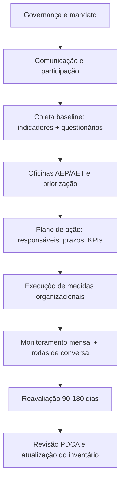

# Treinamentos e rodas de conversa baseados em evidências para prevenir riscos psicossociais no trabalho no Brasil

## Sumário executivo

A atualização do capítulo 1.5 da NR-01 (GRO/PGR) passou a exigir, de forma **expressa**, que as organizações incluam **fatores de risco psicossociais relacionados ao trabalho** no gerenciamento de riscos ocupacionais, integrando-os ao **inventário de riscos** e ao **plano de ação**, em articulação com a NR-17 (Ergonomia) e seus métodos (AEP/AET). citeturn12view0turn12view1turn16view0turn6view1turn6view2

O próprio guia oficial de apoio à implementação deixa claro um ponto decisivo para quem atua como **facilitador(a) não psicólogo(a)**: o foco do processo é **avaliar e melhorar condições/organização do trabalho** (perigos e exposição), **não** “medir saúde mental individual” nem realizar “avaliação psicossocial” clínica. Em outras palavras: **você pode (e deve) facilitar processos participativos de identificação, priorização, plano de ação e monitoramento de indicadores**, desde que não transforme esses instrumentos em **avaliação psicológica individual**. citeturn12view1turn12view4turn16view0

Há um marco temporal que orienta urgência e planejamento: o entity["organization","Ministério do Trabalho e Emprego","brazilian labor ministry"] comunicou que a inclusão entra **em caráter educativo/orientativo** e que a autuação passaria a ocorrer apenas após o período de adaptação; a prorrogação/ajuste de vigência do capítulo 1.5 foi formalizada por portaria publicada no DOU. citeturn16view0turn6view0turn5view0turn6view1

Este relatório propõe um **sistema completo e mensurável**, compatível com NR-01/NR-17 e aplicável em múltiplas realidades (setores, portes e níveis de escolaridade), composto por:

Um **ciclo PDCA** (planejar–executar–checar–agir) com governança e participação (CIPA/representações), combinando: (a) **questionários de condições psicossociais do trabalho** (exposição), (b) **indicadores administrativos** (absenteísmo, rotatividade, horas extras, denúncias/ocorrências), (c) **métodos participativos** (oficinas, rodas, observação do trabalho real) e (d) **avaliação pré/pós** com métricas quantitativas e qualitativas. citeturn12view2turn12view3turn19view1turn16view0

Para monitoramento sem “testes exclusivos de psicólogo”, recomenda-se priorizar instrumentos voltados ao **desenho e organização do trabalho** (ex.: COPSOQ II-Br; HSE Indicator Tool; Job Stress Scale; ERI), além de um **indicador breve de bem-estar** para acompanhamento agregado e de segurança (ex.: WHO‑5), sempre com regras de privacidade e encaminhamento quando necessário. citeturn31search1turn24search3turn19view0turn24search0turn31search3turn17search3

Quanto ao conteúdo pedagógico, a evidência internacional converge: intervenções mais eficazes para riscos psicossociais tendem a combinar **mudanças organizacionais** e **participação estruturada**; treinamentos isolados focados só em “resiliência” têm efeito limitado se não houver correção das causas (demandas excessivas, baixo controle, injustiça, assédio, jornadas). citeturn29search12turn28search1turn28search0turn28search15

---

## Requisitos normativos e guias brasileiros

A exigência central é que o GRO/PGR deve abranger também os riscos decorrentes de **fatores ergonômicos, incluindo os fatores de risco psicossociais relacionados ao trabalho**, e que esses fatores sejam tratados com o mesmo rigor de identificação, avaliação, classificação, plano de ação e acompanhamento. citeturn12view0turn12view1turn2view0turn2view1

### O que muda na prática com a inclusão explícita

O guia oficial para aplicação do capítulo 1.5 reforça três consequências práticas:

A NR-01 passa a **afirmar explicitamente** a inclusão dos fatores psicossociais no GRO, vinculando-os à lógica de inventário e plano de ação. citeturn12view0turn6view1turn16view0

A gestão deve ocorrer **de forma combinada com a NR-17**, entendendo os fatores psicossociais como parte da **organização do trabalho**, e operacionalizando por **Avaliação Ergonômica Preliminar (AEP)** e, quando aplicável, **Análise Ergonômica do Trabalho (AET)**. citeturn12view0turn12view1turn6view2turn16view0

A avaliação deve considerar **exigências da atividade de trabalho** e a **eficácia das medidas de prevenção**; e explicitamente não se trata de “verificar sintomas individuais”, mas de verificar condições a que o trabalhador está submetido. citeturn12view1turn12view4

### Prazos, caráter educativo e fiscalização

O MTE comunicou um período de implementação **educativa/orientativa** e a data a partir da qual a autuação poderia ocorrer, além do lançamento de guia e manual de apoio. citeturn16view0turn16view2

A alteração do capítulo 1.5 e do anexo de termos/definições foi formalizada em portaria publicada no DOU, e houve prorrogação/ajuste de vigência por portaria posterior (também publicada no DOU). citeturn6view1turn6view0turn5view0

### Quem pode conduzir e apoiar o processo

A norma e o guia explicitam que **não há um profissional único definido** para conduzir identificação e avaliação; é responsabilidade da organização definir responsáveis com conhecimento técnico adequado. A orientação técnica da inspeção reforça o PGR como **programa de gestão**, não mero documento, e aponta necessidade de competência técnica compatível com os riscos existentes. citeturn12view4turn15view0

Para o seu caso (facilitador(a) não psicólogo(a)), isso abre espaço para atuar com segurança em:

mobilização, comunicação, desenho de oficinas/rodas, facilitação participativa, coleta de percepções sobre condições de trabalho, sistematização de planos de ação, apoio ao monitoramento e à revisão PDCA — desde que os limites de “avaliação psicológica” e “testes psicológicos” sejam respeitados (ver seção de ética). citeturn12view2turn12view4turn15view0turn30search6

### Integração com CIPA e prevenção de assédio e violência

A NR-05 (CIPA) incorpora a dimensão de **assédio** e prevê diretrizes relacionadas a prevenção e atuação, e a legislação federal reforça a obrigatoriedade de CIPA e medidas de prevenção. citeturn9view0turn9view1turn32search1

Como consequência operacional, treinamentos e rodas de conversa devem dialogar com: canais de relato, procedimentos internos, proteção contra retaliação, e comissões/grupos de acompanhamento de ações. citeturn12view3turn9view0turn16view0

### Fontes oficiais e referências em português prioritárias

Para conformidade e atualização contínua, priorize: textos vigentes da NR-01/NR-17/NR-05 no portal do governo, o guia de aplicação do capítulo 1.5, portarias no DOU e materiais técnicos da entity["organization","Fundacentro","brazilian osh research institute"] (ergonomia, GRO e organização do trabalho). citeturn13search4turn3search0turn7search4turn11view0turn0search34

---

## Riscos psicossociais prioritários e base de evidências

A literatura científica converge que riscos psicossociais “maiores” são aqueles que combinam **exposição frequente/intensa** com **baixa capacidade de controle/participação**, e que tendem a se manifestar como adoecimento mental, problemas cardiovasculares, pior sono, aumento de acidentes, absenteísmo e rotatividade. citeturn28search4turn26search0turn27search0turn26search2

O guia oficial brasileiro define os fatores psicossociais “relacionados ao trabalho” como perigos decorrentes de problemas na concepção/organização/gestão do trabalho, com efeitos psicológicos, físicos e sociais; e reforça que o foco é **condição de trabalho**, não exame individual. citeturn12view1turn12view4

Abaixo está um conjunto de prioridades, organizado por “famílias” de risco, com evidências-chave.

### Demandas elevadas, intensidade e pressão de tempo

“Alta demanda” (carga, ritmo, prazos, interrupções, multitarefa) associada a baixo controle está ligada a maior risco de doença coronariana (efeito pequeno, porém consistente) em meta-análise colaborativa com dados individuais. citeturn26search0turn26search4

Demandas elevadas e estressores do trabalho fazem parte dos fatores de risco psicossociais com associações importantes com transtornos mentais relacionados ao estresse em revisão sistemática recente. citeturn28search15turn27search33

### Baixo controle, baixa autonomia e baixa participação

Modelos clássicos de estresse ocupacional indicam que a combinação de alta demanda com baixo controle (job strain) é crítica; e revisões sistemáticas reforçam sua relevância preditiva para desfechos de saúde mental e depressão (com variação conforme métricas e populações). citeturn26search1turn26search25

No contexto regulatório brasileiro, a integração NR‑01/NR‑17 aponta para a necessidade de olhar a atividade real, margem de manobra e organização do trabalho via AEP/AET. citeturn12view0turn6view2

### Baixo suporte social, liderança inadequada e relações conflituosas

Instrumentos amplamente usados em gestão de estresse no trabalho (como o HSE Indicator Tool) tratam suporte de pares e chefias e relacionamento como domínios centrais; e seu manual recomenda validar achados quantitativos com discussão estruturada (ex.: grupos focais). citeturn19view0turn19view1turn20view3

Treinamentos de gestores em saúde mental no trabalho, em meta-análise, tendem a melhorar conhecimento/atitudes e comportamento autorrelatado de suporte; e há ensaio controlado sugerindo impacto em absenteísmo por adoecimento relacionado ao trabalho, embora generalização exija cautela. citeturn28search2turn28search6turn28search9

### Desequilíbrio esforço–recompensa, reconhecimento e justiça organizacional

O modelo esforço–recompensa (ERI) é uma das bases com forte evidência: meta-análise indica associação com aumento de risco de doença coronariana, independente de job strain. citeturn27search0turn27search8

Para depressão, revisão e meta-análise de coortes prospectivas aponta maior risco de transtornos depressivos entre expostos a ERI. citeturn27search1turn27search29

Em revisão sobre fatores de risco psicossociais para transtornos mentais relacionados ao estresse, ERI, baixa justiça organizacional e altas demandas aparecem entre os fatores com maiores aumentos de risco. citeturn28search15

### Jornadas longas, turnos e descanso insuficiente

Meta-análise com grande base prospectiva encontrou associação dose–resposta entre longas jornadas (especialmente ≥55h/semana) e maior risco de AVC, e associação mais modesta com doença coronariana. citeturn26search2turn26search6

Trabalho em turnos está associado a pior saúde mental agregada em meta-análise; e revisões específicas sugerem aumento de risco para depressão em trabalho noturno em parte da literatura. citeturn27search3turn27search11turn27search35

### Assédio moral/sexual, bullying, violência e eventos traumáticos

Bullying/assédio no trabalho se associa a pior saúde mental em meta-análise e revisão sistemática. citeturn26search19turn26search7

Para uso no Brasil, há evidências psicométricas de instrumentos adaptados (ex.: NAQ‑R) em diferentes amostras, apoiando monitoramento de exposição a atos negativos (sempre com cautela de confidencialidade e não retaliação). citeturn17search12turn17search24turn17search4

Do ponto de vista normativo, prevenção e tratamento de assédio/violência também se conectam a obrigações de CIPA. citeturn9view0turn32search1

### Insegurança no emprego e precarização

Revisões e meta-análises indicam associação entre insegurança no emprego/desemprego e sintomas depressivos e pior saúde mental em estudos prospectivos. citeturn27search14turn27search26turn27search38

### Por que priorizar “causas do trabalho” em vez de “resiliência do indivíduo”

Diretrizes internacionais de saúde mental no trabalho recomendam foco em **intervenções organizacionais** para prevenir exposição a riscos psicossociais, combinado com treinamento de gestores e trabalhadores e sistemas de suporte/retorno ao trabalho. citeturn29search12turn29search0turn29search5

O guia oficial brasileiro ecoa isso: intervenções devem se concentrar em **modificar condições organizacionais do trabalho**, com participação e acompanhamento no tempo. citeturn12view3turn12view4turn16view0

---

## Instrumentos e indicadores não privativos para monitoramento

### Princípios para escolher instrumentos no seu contexto

O guia oficial afirma que o MTE **não indica ferramenta específica**; é responsabilidade da organização selecionar metodologia adequada ao risco e circunstância. citeturn12view4

Para compatibilidade com NR-01/NR-17 e com atuação de facilitador(a) não psicólogo(a), priorize instrumentos que:

medem **condições do trabalho** (demandas, controle, mudanças, relações, assédio, recompensa), e não traços psicológicos individuais; citeturn12view1turn12view4

são aplicáveis em **nível de grupo** (setor/equipe/unidade), com resultados agregados e anonimização; citeturn19view1turn12view3

têm evidência psicométrica em português (idealmente Brasil) e termos claros de licença; citeturn24search3turn24search0turn31search3turn31search1

permitem “monitorar melhoria” (reaplicação) e se integram ao PDCA/GRO. citeturn19view1turn12view1turn16view0

### Tabela comparativa de instrumentos recomendados

| Constructo monitorado (exposição/resultado) | Instrumento (pt‑BR) | Itens / tempo | Evidência psicométrica (Brasil) | Escore e interpretação prática | Limiares/alertas sugeridos | Licença / restrições relevantes |
|---|---:|---:|---|---|---|---|
| Riscos psicossociais do trabalho (multidomínios) | **COPSOQ II‑Br (versão curta)** | 40 itens; ~10–15 min | Adaptação transcultural e propriedades psicométricas: alfas ~0,70–0,87; ICC teste‑reteste ~0,71–0,81 (dimensões). citeturn24search3turn24search15 | Em geral, escores por dimensão (frequentemente transformáveis em 0–100; direção varia por dimensão). Usar benchmarking interno por equipe/unidade + tendência temporal. citeturn24search3turn31search4 | Como não há “cutoff universal” para todas dimensões, usar **quartis/tercis internos** + regra de prioridade: pior quartil + alta severidade/recorrência em indicadores administrativos. citeturn12view1turn12view3 | COPSOQ possui diretrizes de uso e licença “free to use” sob condições e reconhecimento; seguir guias da rede COPSOQ. citeturn31search1turn31search11 |
| Estressores de desenho do trabalho (gestão de estresse) | **HSE Management Standards Indicator Tool** | 35 itens; ~10–15 min | Uso extensivo internacional; manual descreve propósito e uso organizacional. citeturn19view0turn19view1 | Domínios (Demandas, Controle, Suporte, Relações, Papel, Mudanças). Escalas 1–5; menor = pior. Recomenda validar com discussões e outros dados (absenteísmo, turnover). citeturn19view1turn20view3 | Há sistema de cores por percentis (ex.: <20º = ação urgente; 20º–50º = precisa melhorar; 50º–80º = bom com melhorias; ≥80º = manter). citeturn23view1turn23view2 | Ferramentas e PDFs são disponibilizados para uso; seguir orientação de manter texto/escala e anonimato. citeturn18view0turn19view1turn18view1 |
| Demanda‑controle‑apoio (job strain) | **Job Stress Scale (versão resumida)** | 17 itens; ~5–8 min | Adaptação para português e equivalências; amplamente usada em epidemiologia ocupacional no Brasil. citeturn24search0turn24search24 | Subescores: Demanda, Controle, Apoio social. Utilizar mediana/tercis para classificar “alto/baixo” por equipe e acompanhar tendência. citeturn24search0turn24search24 | “Alto desgaste” (alta demanda + baixo controle) pode ser priorizado, especialmente se coincidir com aumento de horas extras, incidentes e absenteísmo. citeturn26search0turn12view3 | Artigo de adaptação é fonte base; verificar termos de uso do instrumento/itens no contexto de aplicação. citeturn24search0 |
| Esforço‑recompensa e overcommitment | **ERI (versão curta)** | ~23 itens; ~7–10 min | Versão brasileira e propriedades psicométricas (consistência, teste‑reteste, estrutura fatorial) descritas. citeturn24search5turn31search17 | Razão esforço/recompensa (ER ratio) frequentemente interpretada como desequilíbrio quando >1 (mais esforço que recompensa), útil como indicador agregado por equipe. citeturn31search17turn27search0 | Alertas: ER ratio elevado + aumento de rotatividade/absenteísmo; repetir trimestral/semestral para ver impacto de ações de reconhecimento/justiça. citeturn27search1turn12view3 | Para uso científico/ensino há convite ao uso; para fins comerciais deve-se contatar detentor de copyright (Siegrist). citeturn31search3 |
| Bullying/atos negativos no trabalho | **NAQ‑R (Questionário de Atos Negativos)** | ~22–23 itens; ~7–10 min | Evidências brasileiras de validade/psicometria em amostras e contextos (ex.: enfermagem). citeturn17search12turn17search24turn17search4 | Frequências em 6 meses; priorizar análise por **unidade** e nunca expor indivíduos. Útil para mapear hotspots e testar efeitos de medidas (canais, liderança, regras). citeturn17search12turn12view3 | Alerta prático: aumento de frequência semanal/diária de atos negativos em uma unidade → intervenção imediata de prevenção/gestão e proteção contra retaliação. citeturn26search19turn9view0 | Verificar fonte do instrumento e condições de reprodução; usar com governança e confidencialidade robusta. citeturn19view1turn9view0 |
| Bem‑estar (triagem leve; não diagnóstico) | **WHO‑5** | 5 itens; 1–2 min | Documento oficial descreve escore e ponto de corte sugerido; instrumento é amplamente utilizado e revisado. citeturn17search3turn17search23 | Soma 0–25; multiplicar por 4 (0–100). Quanto maior, melhor bem‑estar. citeturn17search3 | Escore <50 (ou bruto <13) sugere baixo bem‑estar e necessidade de olhar causas e oferecer encaminhamento/apoio (sem diagnosticar). citeturn17search3 | Termos de uso: gratuito e sem necessidade de permissão (referenciar fonte). citeturn17search35 |
| Exaustão/burnout (resultado) | **Copenhagen Burnout Inventory (CBI)** | 19 itens; ~5–10 min | Validação pt‑BR em profissionais de saúde; ferramenta descrita como “public domain” em estudo. citeturn25search3turn25search7 | Subescalas (pessoal, trabalho, cliente/paciente). Interpretar em nível de grupo; sem uso para seleção/medidas disciplinares. citeturn25search3 | Como cutoffs variam por contexto, usar percentis internos + tendência; tratar aumentos rápidos como sinal de falha de controles (demandas/descanso). citeturn12view1turn26search2 | Preferir uso para monitoramento agregado; combinar com instrumentos de exposição (COPSOQ/HSE/JSS/ERI). citeturn25search3turn12view3 |
| Engajamento/recursos do trabalho | **UWES‑9 (engajamento)** | 9 itens; ~2–3 min | Evidências de validade no Brasil para versões reduzidas. citeturn24search6turn24search22 | Monitorar vigor/dedicação/absorção como indicador positivo (recursos), em conjunto com exposição. citeturn24search6turn28search4 | Sem cutoffs universais; usar normas nacionais quando disponíveis e comparação longitudinal por equipe. citeturn24search10 | Manual indica uso livre para pesquisa científica não comercial; uso comercial/não científico requer permissão dos autores. citeturn25search1 |

### Indicadores psicossociais “administrativos” para o GRO/PGR

Além de questionários, o guia brasileiro recomenda reunir informações do estabelecimento e do acompanhamento de saúde, como registros de afastamentos, CAT, indicadores do PCMSO, análise de acidentes e avaliações anteriores; isso deve alimentar a preparação e a escolha de estratégia de identificação/avaliação, e permitir monitorar eficácia das ações. citeturn12view3turn16view0

Sugestão de *painel mínimo* (para qualquer porte):

Absenteísmo (dias perdidos/100 empregados/mês), rotatividade, horas extras e jornada real, incidentes/near misses, reclamações formais sobre assédio/violência, participação em pausas/rodízios, adesão a treinamentos, resultados agregados de COPSOQ/HSE/JSS/ERI por unidade e ocupação. citeturn19view1turn12view3turn16view0

---

## Protocolo mensurável de avaliação pré e pós intervenção

### Desenho de avaliação recomendado para múltiplas unidades no Brasil

Para maximizar rigor sem exigir ensaio clínico complexo, use um modelo “quase-experimental” com:

Linha de base (T0) → intervenção (treinamento/oficinas/rodas + ações organizacionais) → pós imediato (T1) → seguimento 90 dias (T2) e 180 dias (T3), com comparação por unidade e, se possível, unidade “controle em lista de espera” (rollout escalonado). A reaplicação periódica é coerente com recomendação de revisão e melhoria contínua. citeturn19view1turn12view1turn12view3turn16view0

A escolha de indicadores deve manter foco nas **condições de trabalho** e nos efeitos organizacionais; o guia brasileiro reforça que não é avaliação individual de saúde mental. citeturn12view4

### Conjunto de métricas e metas de efeito

**Desfechos primários (exposição):** mudança nos escores por domínio em COPSOQ II‑Br ou HSE (ex.: Demands, Control, Support, Role, Change) por unidade. citeturn24search3turn19view1turn23view1

**Desfechos secundários (resultado):** WHO‑5 médio por unidade; CBI (opcional) em grupos expostos; absenteísmo, rotatividade e horas extras; eventos de assédio/bullying relatados (agregado). citeturn17search3turn25search3turn12view3turn19view1

**Métricas de processo (fidelidade e alcance):** taxa de participação (%), taxa de resposta ao questionário, presença de plano de ação com responsáveis e prazos, execução de ações do plano (% concluídas), participação de trabalhadores/CIPA, e ocorrência de feedback para a força de trabalho. citeturn19view1turn12view3

**Metas realistas (efeito):** em intervenções organizacionais participativas, efeitos em saúde e ambiente podem ser modestos e dependem de implementação; estudos controlados mostram possibilidade de melhorias quando intervenções são bem executadas e acompanhadas por avaliação de processo. citeturn28search1turn28search0turn28search23

### Tamanho de amostra e taxa de resposta

Como regra operacional, tente medir “toda a unidade” (censo) onde possível; quando não, amostre buscando representatividade por turno, função e local.

Para instrumentos como HSE, o manual discute que taxas de resposta mais altas aumentam confiabilidade e dá referência prática de adequação (com cautela quando <50%). citeturn19view1

Estimativas aproximadas para testes pré/pós (nível individual, pareado; α=0,05; poder=0,80), para um desfecho contínuo padronizado:

| Tamanho de efeito alvo (Cohen’s d) | Interpretação prática | N pareado aproximado necessário* |
|---:|---|---:|
| 0,20 | melhoria pequena (comum em mudanças organizacionais iniciais) | ~200 |
| 0,30 | pequena‑moderada | ~90 |
| 0,40 | moderada | ~50 |
| 0,50 | moderada‑alta (ambiciosa para ambiente organizacional) | ~32 |

\*Estimativas por aproximação normal; em cluster (por equipe/unidade) ajustar por efeito de desenho (ICC) e perdas. Quando você usa rollout por unidades, modelos mistos são mais adequados.

### Análises estatísticas recomendadas (robustas e compreensíveis)

Para dados contínuos por pessoa (pré/pós): t pareado (ou Wilcoxon), com **tamanho de efeito** (Cohen’s d pareado) e IC95%.

Para comparações por unidade (antes/depois e entre unidades): modelos lineares mistos (pessoa dentro de unidade) ou diferença‑em‑diferenças quando há unidade controle/rollout.

Para proporções (ex.: % com WHO‑5<50; % que relatou bullying semanal): McNemar (pareado) ou regressões (logística/Poisson robusta) com efeitos aleatórios por unidade. Limiares do WHO‑5 são descritos em documento oficial. citeturn17search3turn19view1

### Componente qualitativo obrigatório para riscos psicossociais

Por recomendação metodológica e também por exigência prática, todo resultado de questionário deve ser “confirmado” por diálogo estruturado com trabalhadores e triangulado com dados organizacionais; isso é explicitamente recomendado no manual do HSE. citeturn19view1

Portanto, sempre inclua:

grupos focais / rodas com roteiro; análise temática rápida; registro de “barreiras e facilitadores” e de ações sugeridas; e validação do plano de ação com trabalhadores e CIPA. citeturn19view1turn12view3turn9view0

---

## Planos de sessão e materiais para treinamentos e rodas de conversa

A seguir estão planos “modulares” (adaptáveis), desenhados para serem conduzidos por facilitador(a) não psicólogo(a), com foco em condições de trabalho, participação e ações mensuráveis, conforme guia oficial (envolver partes interessadas, atribuir responsabilidades, comunicar trabalhadores, documentar e acompanhar). citeturn12view2turn12view3turn16view0

image_group{"layout":"carousel","aspect_ratio":"16:9","query":["diagrama modelo demanda controle apoio social karasek","hierarquia de controles riscos ocupacionais diagrama","ciclo PDCA segurança e saúde no trabalho infográfico","matriz de risco probabilidade severidade ergonomia diagrama"],"num_per_query":1}

### Arquitetura do programa em camadas

Para dar escala nacional e atender diferentes letramentos, use três níveis:

Camada universal (todos): alfabetização de risco psicossocial, direitos/deveres, canais e participação.

Camada por função (lideranças, RH, SST, CIPA): competências para mudar organização do trabalho (demandas, controle, escalas, pausas, metas, comunicação, feedback e gestão de conflitos) e monitorar indicadores.

Camada por risco (unidades críticas): oficinas AEP/AET focadas em hotspots (setores com elevados escores ou indicadores de adoecimento/rotatividade). citeturn12view0turn12view3turn16view0turn19view1

### Sessão tipo para trabalhadores

**Formato:** treinamento participativo de 2h (presencial) ou 2h30 (online com pausas).  
**Objetivos mensuráveis:**

Aumentar conhecimento sobre riscos psicossociais relacionados ao trabalho e sobre o ciclo GRO/PGR (pré/pós teste simples de 6 itens).

Identificar 3–5 perigos psicossociais da unidade (lista priorizada) e registrar ao menos 2 ações de melhoria sob responsabilidade do gestor/unidade.

Consolidar regras de segurança psicológica para rodas e canais (cartaz de acordos). citeturn12view2turn16view0turn19view1

**Roteiro passo a passo:**

Abertura e contrato (10 min).  
Script: “Hoje não vamos avaliar a saúde mental individual de ninguém. Vamos mapear condições de trabalho que geram estressores e registrar ações de melhoria. O que for compartilhado aqui será tratado de forma agregada e com respeito.”

Mapa simples do que a NR-01/NR-17 pede (15 min).  
Use um slide com: Identificar → Avaliar → Classificar → Plano de ação → Acompanhar/ revisão. Conectar com AEP. citeturn12view0turn12view3

Atividade 1: “Cartões de trabalho real” (25 min).  
Material: cartões com frases/ícones (metas, ritmo, pausa, turno, apoio, comunicação, assédio, reconhecimento, segurança).  
Dinâmica: em duplas, escolher 2 cartões “mais presentes” e 1 “piorou nos últimos 6 meses”.  
Saída: mural por categoria (Demanda/Controle/Suporte/Relações/Mudança/Recompensa).

Microaula: “O que a evidência diz” (10 min).  
Explicar em linguagem simples: demanda+baixo controle; esforço>recompensa; longas jornadas; assédio. Concluir: “mudanças na organização do trabalho são o centro”. citeturn26search0turn27search0turn26search2turn12view3

Atividade 2: “Priorização por impacto e viabilidade” (20 min).  
Use matriz 2x2 (Impacto alto/baixo × Viabilidade alta/baixa) e peça que o grupo posicione 5 problemas do mural.

Atividade 3: “Plano de ação 5W2H do setor” (30 min).  
Para os 2 itens mais prioritários, preencha: O quê, Por quê, Quem, Quando, Onde, Como, Quanto (recursos). Exigir indicador de sucesso (ex.: reduzir horas extras >X%; aumentar pausas; melhorar escore HSE Demands; reduzir queixas). citeturn12view3turn19view1

Fechamento e feedback (10 min).  
Pergunta final: “O que precisa mudar no trabalho para o trabalho caber na vida?”

**Adaptação para baixa escolaridade:** use ícones, dramatizações curtas (“cena de 2 minutos”), votação por adesivos (verde/vermelho) e leitura em voz alta.  
**Adaptação para setores:**  
Saúde/atendimento: incluir “demanda emocional” e eventos críticos; turnos e descanso. citeturn27search3turn27search11  
Construção/indústria: reforçar relação estresse–segurança e fadiga–acidentes; ritmo e pausas. citeturn28search0turn26search2  
Call center/serviços: metas, monitoramento, autonomia, pausas, script e assédio de clientes. citeturn12view1turn28search4

### Oficina de diagnóstico e AEP psicossocial

**Formato:** 4h (presencial) com grupo de trabalho (SST + CIPA + gestão + trabalhadores).  
**Objetivos:** produzir “mini‑inventário psicossocial” por atividade e um plano de ação com responsáveis, prazos e indicadores.

**Passos:**

Preparação (antes da oficina): coletar indicadores administrativos (absenteísmo, horas extras, rotatividade, registros) e resultados de questionário (COPSOQ/HSE/JSS/ERI) agregados por unidade. citeturn12view3turn19view1

Mapeamento do trabalho real (60 min): “sequência da atividade” (o que acontece, onde travam, onde há retrabalho, pressão, conflitos, falta de recurso). Conectar com organização do trabalho (NR-17). citeturn12view0turn6view2

Identificação de perigos psicossociais (45 min): usar checklist estruturado (demandas, controle, suporte, relações, mudança, recompensa, jornada, assédio).

Avaliação e classificação (45 min): definir critérios (probabilidade/severidade) coerentes com PGR; documentar (NR‑01). citeturn12view3turn2view1

Desenho de medidas (60 min): priorizar medidas que alterem condições organizacionais (ex.: dimensionamento, redistribuição de carga, pausas, autonomia, comunicação, regrar metas, treinamento continuado, procedimentos contra assédio). citeturn12view3turn12view4

Plano de ação e monitoramento (30 min): KPIs e agenda de revisão.

### Roda de conversa estruturada

**Formato:** grupo de 8–15 pessoas; 60–90 min; ciclo de 6 encontros quinzenais; registro *sem nomes*.  
**Objetivo:** transformar percepção em ações e acompanhar execução (não terapia).

**Estrutura fixa (para todos os encontros):**

Acordos (5 min): confidencialidade, respeito, direito de passar, foco no trabalho, sem relatos identificáveis.

Termômetro do trabalho (10 min): cada pessoa marca em cartão 0–10 “pressão de tempo” e “apoio recebido”; recolher para média do grupo.

Discussão guiada (30–40 min): tema do encontro.

Fechamento com “pedido concreto” (10 min): 1 mudança possível nesta quinzena.

Registro (5 min): facilitador anota “problema → causa no trabalho → ação responsável → indicador”.

**Temas dos 6 encontros:**

Demanda e ritmo: “o que impede entregar com qualidade sem correr?”.  
Controle e autonomia: “onde temos margem de manobra?”.  
Suporte e comunicação: “o que falta da liderança e entre pares?”. citeturn19view1turn28search2  
Mudanças e justiça: “mudanças recentes e como foram comunicadas?”.  
Jornadas e descanso: “onde a fadiga está aparecendo?”. citeturn26search2turn27search3  
Respeito e prevenção de assédio: “como agir e onde relatar com segurança?”. citeturn9view0turn26search19

### Checklist de competência do(a) facilitador(a) não psicólogo(a)

| Domínio | Critério observável (sim/não) | Evidência/ancoragem normativa |
|---|---|---|
| Conformidade NR | Explica claramente que se trata de gestão de riscos do trabalho (não avaliação clínica individual) | citeturn12view4turn16view0 |
| Facilitação | Conduz grupos com regras, tempo, participação equitativa e manejo de conflito | citeturn19view1 |
| Segurança psicológica | Mantém acordos e protege participantes de exposição/retaliação | citeturn19view1turn9view0 |
| Métodos participativos | Consegue produzir lista priorizada e plano 5W2H com indicadores | citeturn12view3 |
| Dados e privacidade | Usa coleta mínima, anonimiza e reporta agregado | citeturn19view1turn32search0 |
| Encaminhamento | Reconhece sinais de sofrimento grave e aciona fluxo de cuidado | citeturn12view3turn30search0turn30search1 |

### Materiais prontos sugeridos

Modelos de “handouts” (1 página cada):

“Mapa de riscos psicossociais do meu trabalho” (ícones + exemplos + como relatar).

“Plano de ação do setor” (5W2H + KPI + data de revisão).

“Regra de ouro da roda”: 4 frases orientadoras para dar voz sem expor pessoas (“Falo do trabalho, não de indivíduos”; “Descrevo fatos e condições”; “Proponho mudança possível”; “Registro indicador”).

Estrutura de slides (12–15 slides):

O que mudou na NR‑01; o que é risco psicossocial relacionado ao trabalho; exemplos; ciclo GRO/PGR e AEP/AET; indicadores e instrumentos; como funciona o plano de ação; canais e não retaliação; como mediremos a mudança. citeturn12view0turn12view3turn16view0

Sugestões de buscas para diagramas/imagens (para slides):

“modelo demanda controle karasek diagrama”, “effort reward imbalance siegrist diagrama”, “HSE management standards demandas controle suporte relações papel mudança”, “PDCA segurança e saúde no trabalho”, “hierarquia de controles riscos ocupacionais”.

---

## Plano de implementação, orçamento e painel de monitoramento

### Fluxo macro de implementação

### Cronograma sugerido

O guia oficial recomenda preparar a organização, definir critérios, escolher estratégia (observação, questionários, oficinas ou combinação), documentar e acompanhar com participação dos trabalhadores; o manual do HSE reforça ciclos de reavaliação e feedback. citeturn12view3turn19view1turn16view0

Abaixo um cronograma “12 semanas + manutenção” (adaptável a rollout nacional):

**Semanas 1–2:** governança (SST/RH/CIPA), comunicação e regras de anonimato; seleção de instrumentos.

**Semanas 3–4:** baseline (questionários + indicadores administrativos) e leitura de dados.

**Semanas 5–6:** oficinas AEP por unidade e priorização; desenho do plano.

**Semanas 7–10:** execução de medidas (metas/jornada/pausas/redistribuição/treinamento de liderança/canais).

**Semanas 11–12:** checagem rápida (mini‑survey + roda + indicadores), ajuste do plano.

**Mensal:** dashboard e comitê.

**Trimestral/Semestral:** reaplicação completa e revisão do inventário. citeturn12view3turn19view1turn12view1

### Entregáveis mínimos (para auditoria e para gestão)

| Entregável | Conteúdo | Evidência normativa/guia |
|---|---|---|
| Termo de governança | responsáveis, escopo, unidades, calendário | citeturn12view2turn15view0 |
| Critérios de avaliação | probabilidade/severidade e regras de decisão | citeturn12view3turn2view1 |
| Inventário psicossocial | perigos por atividade/unidade + avaliação | citeturn12view0turn16view0 |
| Plano de ação | ações, responsáveis, prazos, KPIs | citeturn12view3turn16view0 |
| Evidência de participação | atas, listas, síntese de rodas | citeturn12view3turn9view0 |
| Relatório de monitoramento | dashboard e revisão PDCA | citeturn12view1turn19view1 |

### Template de orçamento

Valores variam por região/setor. Use um orçamento por “núcleo central” + “custo por unidade”.

| Categoria | Unidade de medida | Cálculo | Observações |
|---|---|---|---|
| Facilitação | hora/dia | nº facilitadores × horas × taxa | incluir preparação e relatórios |
| Tradução/adaptação | pacote | por setor/nível de letramento | linguagem simples e materiais visuais |
| Coleta de dados | pacote | plataforma + impressos + logística | garantir opção papel (HSE recomenda acesso a quem não tem computador) citeturn19view1 |
| Análise e dashboard | pacote | planilhas/BI + analista | incluir anonimização e validação |
| Treinamento de lideranças | turma | nº turmas × horas | apoiar mudanças organizacionais citeturn28search2turn28search6 |
| Encontros de CIPA/comitê | mensal | nº reuniões × horas | governança e participação citeturn9view0turn12view3 |
| Deslocamentos | por visita | km/diárias | para unidades remotas |
| Incentivos | por resposta | brindes/sorteios | HSE indica incentivos como estratégia de resposta citeturn19view1 |

### Dashboard de monitoramento mensal

| Indicador | Fonte | Frequência | Regra de alerta | Ação gatilho |
|---|---|---|---|---|
| HSE Demands (média por unidade) | survey | trimestral | <20º percentil (vermelho) | oficina AEP + revisão de carga/recursos citeturn23view1 |
| COPSOQ dimensões críticas | survey | semestral | pior quartil + tendência piorando | plano de ação específico citeturn24search3turn12view3 |
| Horas extras / jornada real | RH | mensal | aumento sustentado | ajuste de dimensionamento/escala citeturn26search2turn12view3 |
| Absenteísmo (dias perdidos) | RH/PCMSO | mensal | acima da linha de base | investigar causas no trabalho citeturn12view3turn19view1 |
| Denúncias/ocorrências de assédio | canal | mensal | aumento por unidade | intervenção imediata e proteção citeturn9view0turn26search19 |
| WHO‑5 médio | survey | trimestral | <50 em unidade (média baixa) | reforçar ações organizacionais + encaminhamento | citeturn17search3turn12view3 |
| Execução do plano | comitê | mensal | <70% ações no prazo | escalonamento para direção | citeturn12view3 |

---

## Ética, privacidade, limites de atuação e encaminhamentos

### Limites de atuação do facilitador não psicólogo

O entity["organization","Conselho Federal de Psicologia","brazilian psychology council"] reforça que o uso profissional de **testes psicológicos** é privativo de psicólogos, conforme a Lei 4.119/1962, e que testes psicológicos podem abarcar escalas, inventários e questionários no contexto de **avaliação psicológica**. citeturn30search6turn30search8turn7search35

Como conciliar isso com a NR‑01?

Você pode aplicar **instrumentos de gestão de riscos do trabalho** e de clima/condições laborais (como HSE/COPSOQ/JSS/ERI) como parte do GRO/PGR, desde que:

o objetivo seja **prevenção e melhoria das condições de trabalho**, com análise agregada e participação;

não se faça **psicodiagnóstico**, laudos psicológicos, seleção/promoção/demissão baseadas em escores;

quando houver dúvida se um instrumento é “teste psicológico” para fins de avaliação psicológica, trate como **zona de risco** e busque apoio de psicólogo(a) do trabalho/SESMT jurídico/compliance. citeturn12view4turn15view0turn30search20

O próprio guia do MTE orienta a verificar se é necessário “ajuda especializada” e envolver profissionais e representações de trabalhadores. citeturn12view2turn16view0

### LGPD e dados sensíveis

Riscos psicossociais podem envolver dados pessoais; e dados referentes à **saúde** são “dados pessoais sensíveis” na LGPD. Tratar questionários de bem‑estar (WHO‑5), burnout ou registros de saúde exige governança, minimização e base legal apropriada. citeturn32search0turn32search8

Práticas mínimas:

Aplicar e reportar **sempre por grupo**, com tamanho mínimo de célula (ex.: não divulgar resultados de equipes muito pequenas).

Coletar só o necessário (turno, função ampla, unidade), evitando combinações que reidentifiquem pessoas; o manual do HSE alerta para riscos de anonimato quando se adiciona demografia demais. citeturn19view1

Separar claramente “dados de gestão de risco” de “prontuário/saúde ocupacional”; acesso restrito e registro de finalidade.

### Segurança psicológica e prevenção de retaliação

Para riscos psicossociais, sem proteção contra retaliação a taxa de resposta cai e a informação se distorce; o manual do HSE recomenda garantir anonimato, comunicação clara e compromisso de ação. citeturn19view1

Também é coerente com a necessidade de participação da CIPA e trabalhadores no acompanhamento das ações. citeturn12view3turn9view0

### Quando encaminhar para profissionais de saúde mental

Mesmo não fazendo avaliação clínica, rodas e treinamentos podem revelar sofrimento importante. Encaminhe quando houver:

relato de ideação suicida, tentativa ou risco imediato → acione emergência (SAMU 192) e rede local; o serviço é acessado pelo 192 e funciona 24/7. citeturn30search0  
apoio emocional e prevenção do suicídio: entity["organization","CVV","suicide prevention ngo, brazil"] atende pelo telefone 188 (24h e gratuito). citeturn30search1

sinais de crise (desorganização, pânico incapacitante, dissociação, intoxicação, violência iminente) → interromper exposição, acionar serviço médico/urgência e segurança.

assédio/violência com risco ou recorrência → ativar canal formal, CIPA/compliance, preservar evidências e proteger a vítima; não “resolver em roda” se houver risco de exposição. citeturn9view0turn32search1turn26search19

Saída ética importante: manter postura de facilitador(a) de condições de trabalho; não aconselhar clinicamente; “encaminhar e proteger”.

---

